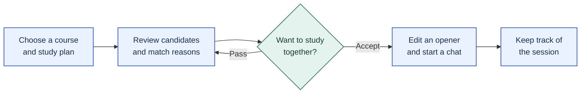
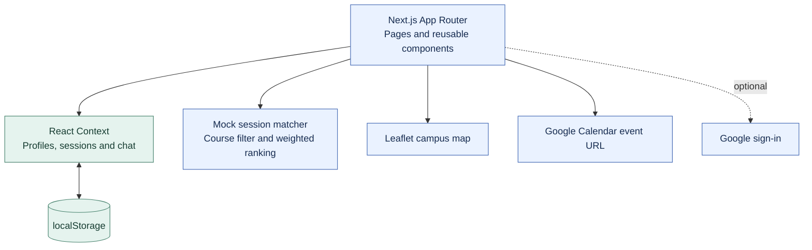

<div align="center">

# StudyLynx

### Find someone you'd actually want to study with.


**English | [简体中文](README.zh-CN.md)**

[Try the demo](https://cloviszhu.github.io/StudyLynx/) · [Source code](src/) · [Report an issue](https://github.com/cloviszhu/StudyLynx/issues)

</div>

Finding someone in your course is a start. You still need to know how they study, what they're working toward, and how to ask them to join you.

StudyLynx turns that awkward first step into a small, concrete plan: choose a session, see why a partner fits, then edit a conversation starter before sending it. It's a mobile-first interaction prototype built for a university course project.

## From a study plan to a conversation



| When you're trying to… | What the prototype does |
| --- | --- |
| Find someone with a similar plan | Filters session matches by course, then ranks candidates using study style, goals and location. Shows up to three candidates. |
| Understand a recommendation | Displays reasons such as a shared course or similar study style directly on the session card. |
| Make first contact | Provides editable prompts for opening a conversation, agreeing on expectations, choosing a time or declining. |
| Keep plans together | Groups sessions by status, reuses weekly availability and opens a prefilled Google Calendar event. |
| Return to a good study partner | Saves partners and keeps separate chat histories in the browser. |

The campus map uses Leaflet and OpenStreetMap. Account profiles, matches and conversations use demo data and browser storage. Messages don't reach other people.

## Try it

Open the **[live prototype](https://cloviszhu.github.io/StudyLynx/)** and select **Sign in with Google (Demo)** when OAuth isn't configured. Browse a recommendation, create a session, or try the editable chat prompts.

To run it locally, use Node.js 20 and npm, matching the repository's deployment workflow:

```sh
git clone https://github.com/cloviszhu/StudyLynx.git
cd StudyLynx
npm ci
npm run dev
```

Open [localhost:3000](http://localhost:3000). The demo doesn't need an API key.

<details>
<summary><strong>Inside the prototype: architecture, matching and source map</strong></summary>



Session matching requires the same course. The ranking then adds weight for study style, a shared goal and location; the first three results become candidates. The separate recommendation feed attaches reason labels to matching attributes. Both paths use the mock dataset.

| Read this file | To understand |
| --- | --- |
| [src/lib/mock-data.ts](src/lib/mock-data.ts) | Candidate ranking, recommendation reasons and chat prompts |
| [src/context/AppStoreContext.tsx](src/context/AppStoreContext.tsx) | State changes across profiles, sessions and conversations |
| [src/lib/store-types.ts](src/lib/store-types.ts) | Data types, browser persistence and store versioning |
| [src/components/RouteGuard.tsx](src/components/RouteGuard.tsx) | Login and profile-completion routing |
| [src/lib/calendar.ts](src/lib/calendar.ts) | Dates and times in the prefilled calendar URL |

</details>

<details>
<summary><strong>Build, hosting and prototype boundaries</strong></summary>

```sh
npm run lint
npm run build
```

The build exports a static site to `out/`. Serve that directory over HTTP for a production preview. This project sets `output: "export"`, so `next start` isn't the preview path for the exported site.

[The GitHub Pages workflow](.github/workflows/deploy-github-pages.yml) sets `NEXT_PUBLIC_BASE_PATH` to the repository path and deploys the export. Optional Google sign-in uses `NEXT_PUBLIC_GOOGLE_CLIENT_ID`. Without it, the Google button opens a demo session.

Calendar export opens an event creation page; it doesn't perform background calendar synchronization. Student verification badges and account flows illustrate the design. The repository doesn't provide production identity verification, shared server storage or real-time messaging. Don't enter sensitive personal information into the demo.

</details>

## Research and contribution

A five-person course team studied how students find study partners through questionnaires, semi-structured interviews and prototype evaluation. The team produced personas, design requirements, paper prototypes and three research reports.

Hongyu Zhu participated in the research and interaction design and was the primary developer of the high-fidelity web prototype. Cognitive walkthroughs and usability testing informed iteration. The project makes no claim about commercial adoption or measured improvements in matching success.
