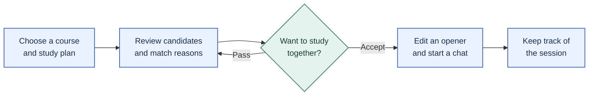
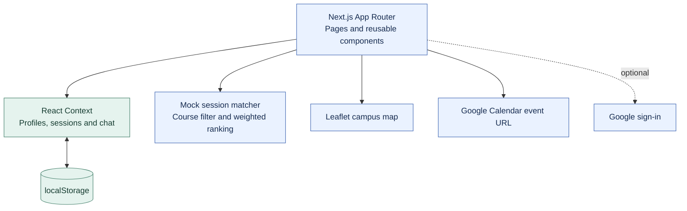
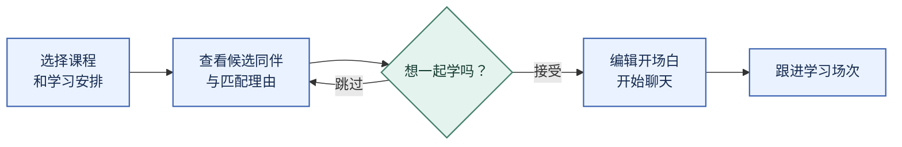
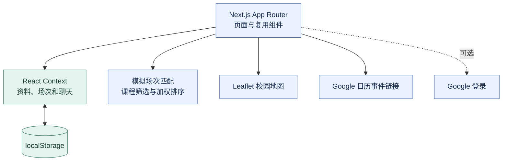

<div align="center">

# StudyLynx

### Find someone you'd actually want to study with.
按课程找到同伴，也让第一句话更容易开口。


**[English](#english) | [简体中文](#简体中文)**

[Try the demo](https://cloviszhu.github.io/StudyLynx/) · [Source code](src/) · [Report an issue](https://github.com/cloviszhu/StudyLynx/issues)

</div>

## English

Finding someone in your course is a start. You still need to know how they study, what they're working toward, and how to ask them to join you.

StudyLynx turns that awkward first step into a small, concrete plan: choose a session, see why a partner fits, then edit a conversation starter before sending it. It's a mobile-first interaction prototype built for a university course project.

### From a study plan to a conversation



| When you're trying to… | What the prototype does |
| --- | --- |
| Find someone with a similar plan | Filters session matches by course, then ranks candidates using study style, goals and location. Shows up to three candidates. |
| Understand a recommendation | Displays reasons such as a shared course or similar study style directly on the session card. |
| Make first contact | Provides editable prompts for opening a conversation, agreeing on expectations, choosing a time or declining. |
| Keep plans together | Groups sessions by status, reuses weekly availability and opens a prefilled Google Calendar event. |
| Return to a good study partner | Saves partners and keeps separate chat histories in the browser. |

The campus map uses Leaflet and OpenStreetMap. Account profiles, matches and conversations use demo data and browser storage. Messages don't reach other people.

### Try it

Open the **[live prototype](https://cloviszhu.github.io/StudyLynx/)** and select **Sign in with Google (Demo)** when OAuth isn't configured. Browse a recommendation, create a session, or try the editable chat prompts.

To run it locally, use Node.js 20 and npm, matching the repository's deployment workflow:

```sh
git clone https://github.com/cloviszhu/StudyLynx.git
cd StudyLynx
npm ci
npm run dev
```

Open [localhost:3000](http://localhost:3000). The demo doesn't need an API key.

<details>
<summary><strong>Inside the prototype: architecture, matching and source map</strong></summary>



Session matching requires the same course. The ranking then adds weight for study style, a shared goal and location; the first three results become candidates. The separate recommendation feed attaches reason labels to matching attributes. Both paths use the mock dataset.

| Read this file | To understand |
| --- | --- |
| [src/lib/mock-data.ts](src/lib/mock-data.ts) | Candidate ranking, recommendation reasons and chat prompts |
| [src/context/AppStoreContext.tsx](src/context/AppStoreContext.tsx) | State changes across profiles, sessions and conversations |
| [src/lib/store-types.ts](src/lib/store-types.ts) | Data types, browser persistence and store versioning |
| [src/components/RouteGuard.tsx](src/components/RouteGuard.tsx) | Login and profile-completion routing |
| [src/lib/calendar.ts](src/lib/calendar.ts) | Dates and times in the prefilled calendar URL |

</details>

<details>
<summary><strong>Build, hosting and prototype boundaries</strong></summary>

```sh
npm run lint
npm run build
```

The build exports a static site to `out/`. Serve that directory over HTTP for a production preview. This project sets `output: "export"`, so `next start` isn't the preview path for the exported site.

[The GitHub Pages workflow](.github/workflows/deploy-github-pages.yml) sets `NEXT_PUBLIC_BASE_PATH` to the repository path and deploys the export. Optional Google sign-in uses `NEXT_PUBLIC_GOOGLE_CLIENT_ID`. Without it, the Google button opens a demo session.

Calendar export opens an event creation page; it doesn't perform background calendar synchronization. Student verification badges and account flows illustrate the design. The repository doesn't provide production identity verification, shared server storage or real-time messaging. Don't enter sensitive personal information into the demo.

</details>

### Research and contribution

A five-person course team studied how students find study partners through questionnaires, semi-structured interviews and prototype evaluation. The team produced personas, design requirements, paper prototypes and three research reports.

Hongyu Zhu participated in the research and interaction design and was the primary developer of the high-fidelity web prototype. Cognitive walkthroughs and usability testing informed iteration. The project makes no claim about commercial adoption or measured improvements in matching success.

[Read in 简体中文](#简体中文)

---

## 简体中文

找到同一门课的同学，只是开始。对方喜欢安静自习还是边学边聊？这次想补进度，还是准备考试？第一句话又该怎么说？

StudyLynx 把这些顾虑放进一次具体的学习安排：先选场次，看看匹配理由，再编辑一句开场白。它是一个以手机界面为主的课程交互原型。

### 从学习安排到第一次交流



| 你想做什么 | 原型如何支持 |
| --- | --- |
| 找到学习安排相近的人 | 先按课程筛选，再按学习风格、目标和地点排序，展示最多三位候选。 |
| 理解推荐理由 | 在场次卡片上直接显示共同课程、相近学习风格等标签。 |
| 迈出第一次联系 | 提供可编辑的话题提示，覆盖开场、对齐预期、约时间和婉拒。 |
| 管理学习安排 | 按状态整理场次，复用每周空闲时间，并打开预填的 Google 日历事件。 |
| 再次联系合适的同伴 | 收藏学习搭子，在浏览器中分别保存聊天记录。 |

校园地图使用 Leaflet 与 OpenStreetMap。资料、匹配和聊天采用演示数据与浏览器存储；消息不会发送给其他人。

### 立即体验

打开 **[在线原型](https://cloviszhu.github.io/StudyLynx/)**。未配置 OAuth 时，点击 **Sign in with Google (Demo)** 即可进入。可以先浏览推荐，再创建场次，试试聊天中的可编辑提示。

本地运行使用 Node.js 20 与 npm，与仓库部署工作流一致：

```sh
git clone https://github.com/cloviszhu/StudyLynx.git
cd StudyLynx
npm ci
npm run dev
```

打开 [localhost:3000](http://localhost:3000)。演示无需 API key。

<details>
<summary><strong>实现细节：架构、匹配逻辑与源码入口</strong></summary>



场次匹配要求课程相同，再根据学习风格、共同目标和地点加权，取前三个结果。推荐信息流另行生成理由标签。两条流程都使用模拟数据。

| 源码 | 阅读重点 |
| --- | --- |
| [src/lib/mock-data.ts](src/lib/mock-data.ts) | 候选排序、推荐理由和聊天提示 |
| [src/context/AppStoreContext.tsx](src/context/AppStoreContext.tsx) | 资料、场次和会话之间的状态变化 |
| [src/lib/store-types.ts](src/lib/store-types.ts) | 类型定义、浏览器持久化和存储版本 |
| [src/components/RouteGuard.tsx](src/components/RouteGuard.tsx) | 登录与资料补全的路由控制 |
| [src/lib/calendar.ts](src/lib/calendar.ts) | 日历链接中的日期与时间 |

</details>

<details>
<summary><strong>构建、托管与原型范围</strong></summary>

```sh
npm run lint
npm run build
```

构建将静态站点导出到 `out/`，通过 HTTP 服务预览该目录。项目配置了 `output: "export"`，因此导出站点不使用 `next start` 预览。

[GitHub Pages 工作流](.github/workflows/deploy-github-pages.yml) 将 `NEXT_PUBLIC_BASE_PATH` 设为仓库路径后发布静态产物。可选的 Google 登录使用 `NEXT_PUBLIC_GOOGLE_CLIENT_ID`；未配置时，按钮进入演示会话。

日历功能会打开预填的事件创建页，不会在后台持续同步。学生认证徽章与账户流程用于展示交互设计；仓库没有提供生产级身份核验、共享服务端存储或实时通信。演示中请勿填写敏感个人信息。

</details>

### 研究与个人贡献

五人课程团队通过问卷、半结构化访谈与原型评估研究学生寻找学习搭子的过程，形成用户角色、设计需求、纸质原型和三份研究报告。

朱泓宇参与用户研究与交互设计，主要负责高保真 Web 原型开发，并结合认知走查和可用性测试迭代。项目不宣称商业采用情况或匹配成功率提升。

[Back to English](#english)
