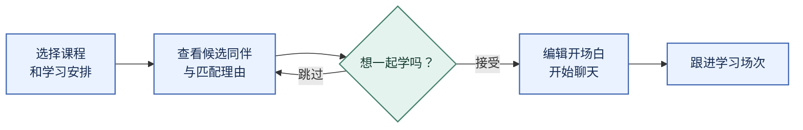
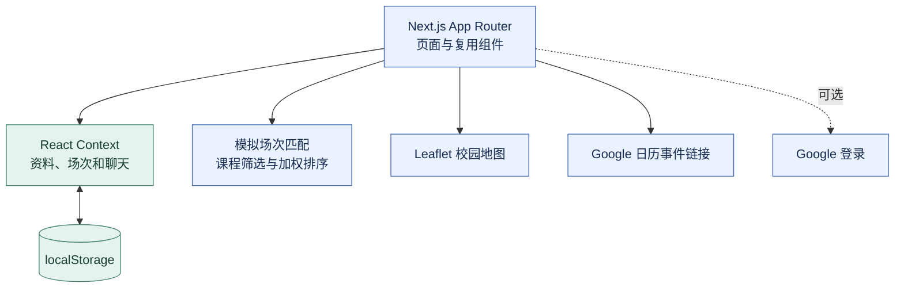

<div align="center">

# StudyLynx

### 按课程找到同伴，也让第一句话更容易开口。


**[English](README.md) | 简体中文**

[在线体验](https://cloviszhu.github.io/StudyLynx/) · [源码](src/) · [反馈问题](https://github.com/cloviszhu/StudyLynx/issues)

</div>

找到同一门课的同学，只是开始。对方喜欢安静自习还是边学边聊？这次想补进度，还是准备考试？第一句话又该怎么说？

StudyLynx 把这些顾虑放进一次具体的学习安排：先选场次，看看匹配理由，再编辑一句开场白。它是一个以手机界面为主的课程交互原型。

## 从学习安排到第一次交流



| 你想做什么 | 原型如何支持 |
| --- | --- |
| 找到学习安排相近的人 | 先按课程筛选，再按学习风格、目标和地点排序，展示最多三位候选。 |
| 理解推荐理由 | 在场次卡片上直接显示共同课程、相近学习风格等标签。 |
| 迈出第一次联系 | 提供可编辑的话题提示，覆盖开场、对齐预期、约时间和婉拒。 |
| 管理学习安排 | 按状态整理场次，复用每周空闲时间，并打开预填的 Google 日历事件。 |
| 再次联系合适的同伴 | 收藏学习搭子，在浏览器中分别保存聊天记录。 |

校园地图使用 Leaflet 与 OpenStreetMap。资料、匹配和聊天采用演示数据与浏览器存储；消息不会发送给其他人。

## 立即体验

打开 **[在线原型](https://cloviszhu.github.io/StudyLynx/)**。未配置 OAuth 时，点击 **Sign in with Google (Demo)** 即可进入。可以先浏览推荐，再创建场次，试试聊天中的可编辑提示。

本地运行使用 Node.js 20 与 npm，与仓库部署工作流一致：

```sh
git clone https://github.com/cloviszhu/StudyLynx.git
cd StudyLynx
npm ci
npm run dev
```

打开 [localhost:3000](http://localhost:3000)。演示无需 API 密钥。

<details>
<summary><strong>实现细节：架构、匹配逻辑与源码入口</strong></summary>



场次匹配要求课程相同，再根据学习风格、共同目标和地点加权，取前三个结果。推荐信息流另行生成理由标签。两条流程都使用模拟数据。

| 源码 | 阅读重点 |
| --- | --- |
| [src/lib/mock-data.ts](src/lib/mock-data.ts) | 候选排序、推荐理由和聊天提示 |
| [src/context/AppStoreContext.tsx](src/context/AppStoreContext.tsx) | 资料、场次和会话之间的状态变化 |
| [src/lib/store-types.ts](src/lib/store-types.ts) | 类型定义、浏览器持久化和存储版本 |
| [src/components/RouteGuard.tsx](src/components/RouteGuard.tsx) | 登录与资料补全的路由控制 |
| [src/lib/calendar.ts](src/lib/calendar.ts) | 日历链接中的日期与时间 |

</details>

<details>
<summary><strong>构建、托管与原型范围</strong></summary>

```sh
npm run lint
npm run build
```

构建将静态站点导出到 `out/`，通过 HTTP 服务预览该目录。项目配置了 `output: "export"`，因此导出站点不使用 `next start` 预览。

[GitHub Pages 工作流](.github/workflows/deploy-github-pages.yml) 将 `NEXT_PUBLIC_BASE_PATH` 设为仓库路径后发布静态产物。可选的 Google 登录使用 `NEXT_PUBLIC_GOOGLE_CLIENT_ID`；未配置时，按钮进入演示会话。

日历功能会打开预填的事件创建页，不会在后台持续同步。学生认证徽章与账户流程用于展示交互设计；仓库没有提供生产级身份核验、共享服务端存储或实时通信。演示中请勿填写敏感个人信息。

</details>

## 研究与个人贡献

五人课程团队通过问卷、半结构化访谈与原型评估研究学生寻找学习搭子的过程，形成用户角色、设计需求、纸质原型和三份研究报告。

朱泓宇参与用户研究与交互设计，主要负责高保真 Web 原型开发，并结合认知走查和可用性测试迭代。项目不宣称商业采用情况或匹配成功率提升。
